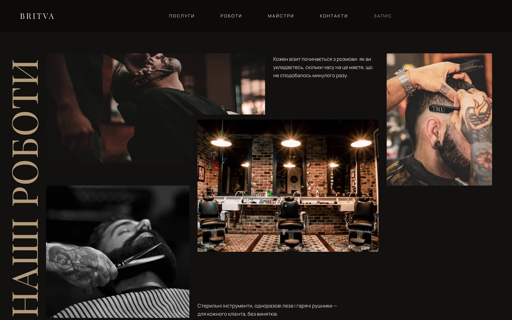
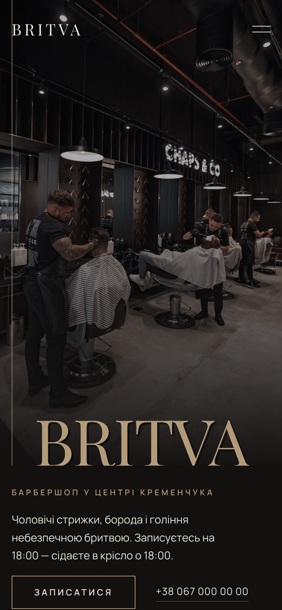
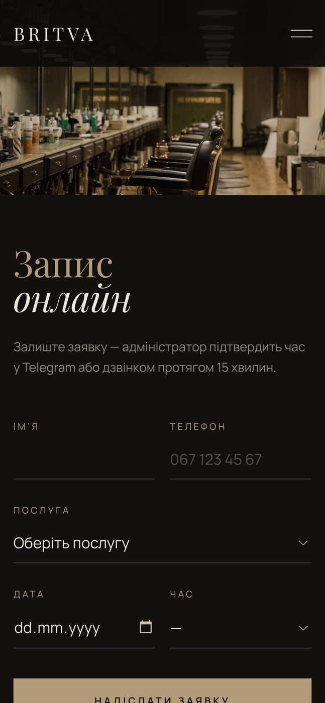

<div align="center">

# BRITVA

**A one-page website concept for a barbershop in Kremenchuk, Ukraine.**

Dark editorial design: an oversized serif headline, a work collage, price menu, barbers, reviews, online booking and a map. Designed and built from scratch — no frameworks, no build step.

[Live site](https://ttjelky.github.io/barbershop-landing/) · [Case study](https://ttjelky.github.io/portfolio/en/work/britva/)




&nbsp;


</div>

## Highlights

- **Editorial look** — reads like a magazine, not a template
- **A mobile layout of its own** — recomposed first screen, full-screen menu, a sticky booking button that appears after the first screen and hides near the form
- **Booking without calls** — a form with phone and date validation, ready to be wired to a Telegram bot
- **Nothing extra** — HTML, CSS and a little JavaScript, deployed on GitHub Pages

**Design & development:** [Oleksii Bezklynskyi](https://ttjelky.github.io/portfolio/) — I build websites for local businesses. Photos: Unsplash.

---

## Для розробника (UA)

Односторінковий сайт для барбершопу в темному editorial-стилі: великий серифний заголовок, колаж робіт, прайс-меню, майстри, відгуки, онлайн-запис, карта. Адаптований під телефон, на мобільному є липка кнопка запису.

Сайт: https://ttjelky.github.io/barbershop-landing/

Без фреймворків і збирання: `index.html` + `styles.css` + `script.js`.

### Як адаптувати під клієнта (30–60 хв)

1. **Назва.** Заміни `BRITVA` в `index.html`. Великий заголовок на першому екрані й у підвалі підлаштовується під ширину; для назви довшої за 7 літер зменш `font-size` у `.hero__title` і `.footer__word`.
2. **Кольори і шрифти.** Блок `:root` на початку `styles.css`: `--tan` — акцент, `--ink` — фон, `--serif` / `--sans` — шрифти (Playfair Display + Manrope, обидва з кирилицею).
3. **Тексти й ціни.** Секції в `index.html` позначені коментарями `<!-- ===== ... ===== -->`. Прайс дублюється у `<select name="service">` форми, тож оновлюй його в обох місцях.
4. **Контакти.** Заміни телефон `+380670000000` усюди (`tel:`-посилання), адресу, Instagram і посилання `https://t.me/`.
5. **Карта.** У `iframe` секції «Контакти» заміни параметр `q=` на адресу клієнта.
6. **Фото.** Зараз це безкоштовні фото з Unsplash (за посиланням `images.unsplash.com`). Для клієнта поклади його фото в `img/` і заміни `src`. Портрети майстрів — вертикальні 3:4, першого екрану — вертикальне, фейд справа знизу — горизонтальне.
7. **Форма запису.** У демо заявка тільки показує повідомлення «Дякуємо». Для робочої версії підключи Telegram-бота (окрема послуга) або Formspree.
8. Прибери рядок «Демо-сайт» у підвалі.

### Локальний запуск

```bash
python3 -m http.server 8000
```

### Оновлення

Після зміни `styles.css` або `script.js` збільш номер версії в `index.html` (`styles.css?v=2` → `?v=3`). Інакше браузери до 10 хвилин показуватимуть старі стилі з кешу.
